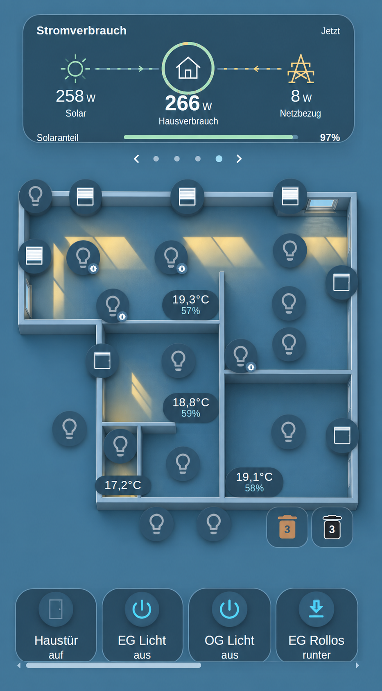

Kellerfeuchtigkeit
Batteriezustand erweitern
Datenpunkt-widget
Wetterwidget erweitern

rework the sunlight floorplan editor. The floorplan itself can be drawn with the editor as well. Migrate the existing eg, og, dg, basement svgs to the new floorplan editor format so we keep compatibility. For the floorplan outer walls and inner walls can be drawn.

add an optional 3d effect to the sunlightfloorplan. if activated it shows the floorplan walls and windows and blind status with a minimalistic 3d effect while keeping the birdview perspective. Keep the overall design style, do not add furnitures. This must not be available for legacy svg-floorplans. see mock image 